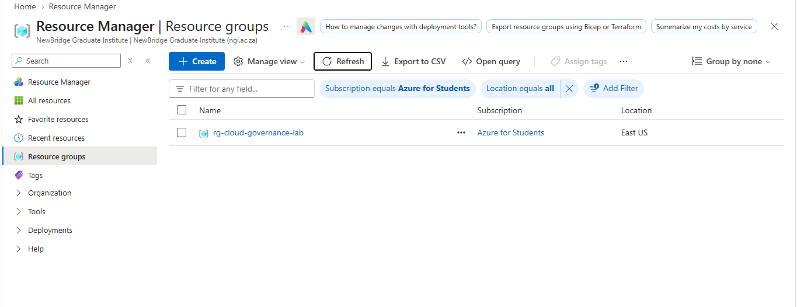
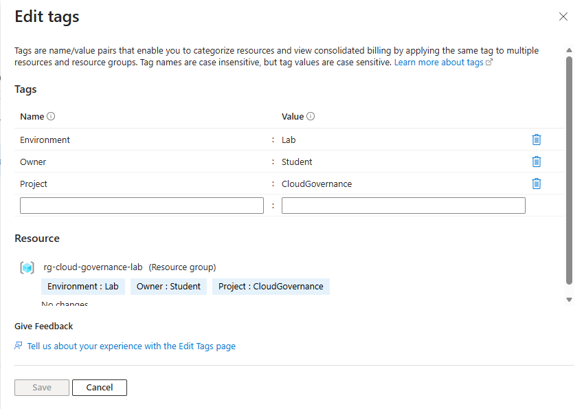
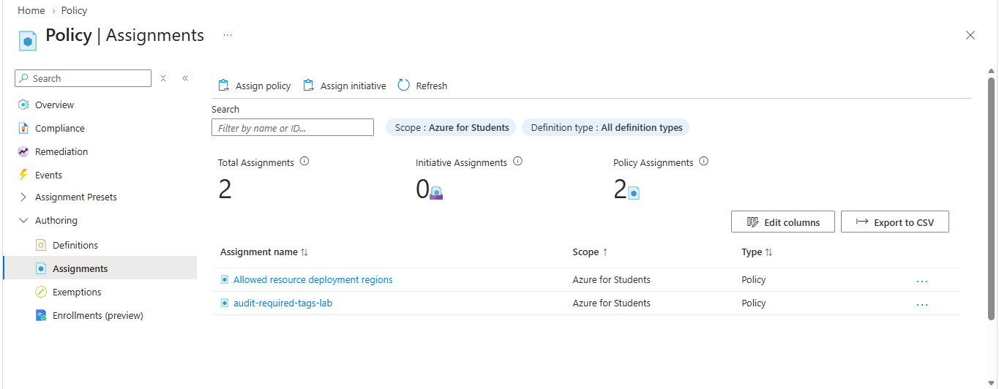
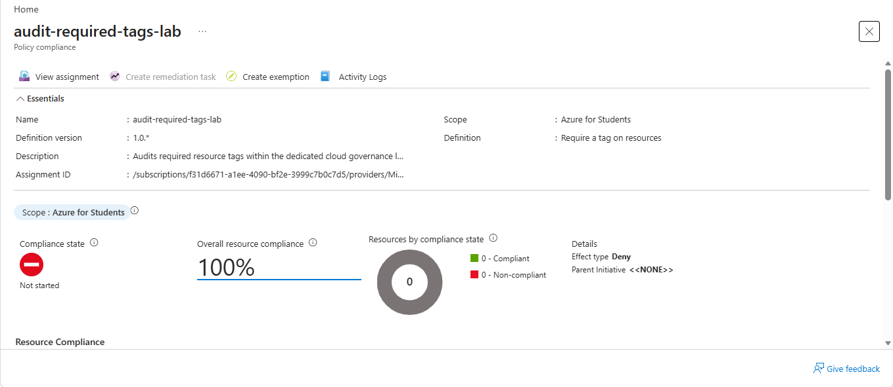
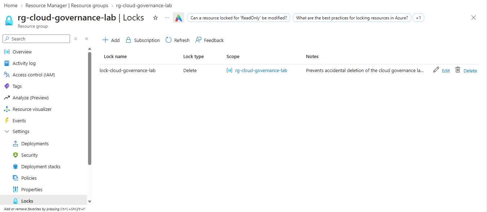
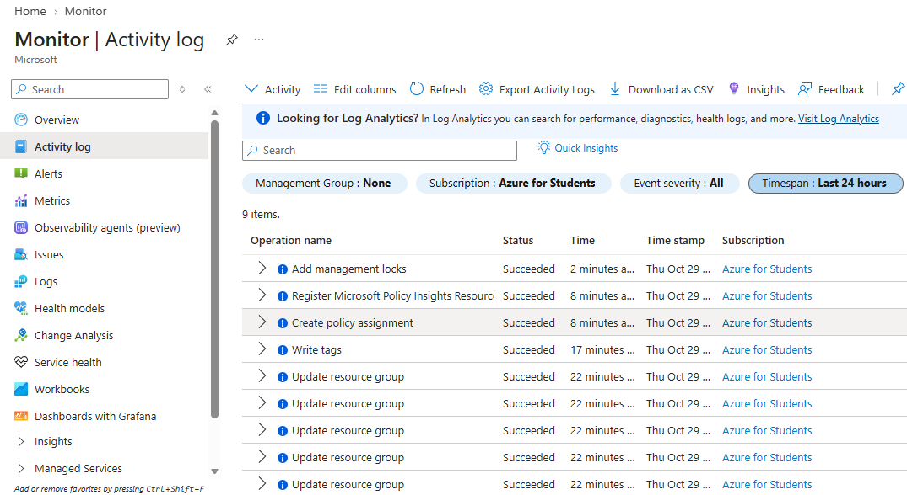

# Azure Cloud Security & Governance Lab

## Project Overview

This project demonstrates the implementation of foundational cloud security and governance controls using Microsoft Azure

The lab covers resource organization through tagging, policy-based compliance auditing, deletion protection using Azure Resource Manager locks, and administrative activity monitoring through Azure Monitor Activity Log

The project was designed to provide practical experience with Azure resource management, cloud governance, security configuration, and technical documentation

**Platform:** Microsoft Azure   
**Environment:** Azure Portal  
**Repository:** `azure-cloud-governance-lab`

## Objectives

- Create and configure a dedicated Azure resource group
- Apply a consistent resource-tagging standard
- Configure an Azure Policy assignment for resource-tag auditing
- Implement a resource lock to help prevent accidental deletion
- Review administrative events through Azure Activity Log
- Verify configurations and document the results using screenshots
- Apply security-conscious resource scoping and cost-awareness practices

## Technologies and Services

| Technology | Purpose |
|---|---|
| Microsoft Azure Portal | Cloud resource configuration and management |
| Azure Resource Manager | Resource organization and management |
| Azure Policy | Governance and compliance evaluation |
| Azure Resource Manager Locks | Protection against accidental deletion |
| Azure Monitor Activity Log | Administrative activity review |
| GitHub | Project documentation and evidence storage |
| Markdown | Technical documentation |

## Implementation

### 1. Azure Resource Group

Created a dedicated resource group named:

`rg-cloud-governance-lab`

The resource group provides an isolated location for the lab's governance configuration and helps separate the exercise from unrelated Azure resources

### 2. Resource Tagging

Configured the following resource-group tags:

| Tag | Value | Purpose |
|---|---|---|
| `Environment` | `Lab` | Identifies the environment |
| `Owner` | `Student` | Identifies the lab owner role |
| `Project` | `CloudGovernance` | Identifies the project |

Resource tags provide metadata that can support resource organization, reporting, governance, and cost-management processes

**Scope note:** Tags applied to a resource group are not automatically inherited by every resource within that group

### 3. Azure Policy

Configured an Azure Policy assignment named:

`audit-required-tags-lab`

The assignment was intended to audit resource tagging within the lab's resource-group scope

The policy-based approach demonstrates how Azure governance controls can be used to evaluate resources against organizational requirements

Policy compliance depends on the assigned definition, its parameters, the resources within scope, and the completion of evaluation. Assignment creation alone does not establish that all resources are compliant

### 4. Resource Lock

Configured a resource lock named:

`lock-cloud-governance-lab`

| Setting | Configuration |
|---|---|
| Lock level | `CanNotDelete` |
| Azure Portal lock type | `Delete` |
| Intended scope | `rg-cloud-governance-lab` |

The `CanNotDelete` lock helps prevent accidental deletion while allowing authorized users to read and modify the protected resource, subject to permissions and other controls

This demonstrates an important cloud administration practice: implementing safeguards that reduce the risk of accidental infrastructure deletion

### 5. Azure Activity Log

Reviewed Azure Activity Log to examine administrative operations associated with Azure resource management

The Activity Log supports investigation of management operations, configuration changes, and failed operations. It can help administrators understand when changes occurred and investigate potential operational issues

The available events depend on the selected subscription, scope, filters, and time range

## Security Considerations

The lab demonstrates several foundational security and governance practices:

- **Resource organization:** A dedicated resource group provides a defined scope for the exercise
- **Governance:** Azure Policy supports evaluating resource configurations against defined requirements
- **Deletion protection:** A `CanNotDelete` lock helps reduce the risk of accidental deletion
- **Auditing:** Activity Log provides visibility into Azure management operations
- **Scope control:** Keeping lab-specific configurations within a dedicated resource group reduces the risk of affecting unrelated resources
- **Cost awareness:** The exercise focuses on governance features rather than deploying unnecessary virtual machines or compute resources

These controls complement other cloud security practices, including least-privilege access, monitoring, backup planning, and identity management

## Results

The project covered the configuration and review of the following Azure governance controls:

| Area | Project outcome |
|---|---|
| Resource management | Dedicated lab resource group configured |
| Resource tagging | Standard tag structure defined and applied |
| Azure Policy | Required-tag audit assignment configured |
| Resource protection | Deletion-lock configuration implemented |
| Administrative auditing | Azure Activity Log reviewed |
| Documentation | GitHub README and screenshot evidence prepared |

Policy compliance results and individual Activity Log events should be interpreted from the captured Azure evidence. A configured policy does not automatically mean that every resource is compliant

## Screenshots and Evidence

The `screenshots/` directory contains visual evidence collected during the lab

### 1. Resource Group Overview

File: `01-resource-group-overview.png`

Documents the dedicated Azure resource group and its overview configuration

### 2. Resource Tags

File: `02-resource-group-tags.png`

Documents the resource-group tagging standard used to identify the environment, owner, and project

### 3. Azure Policy Assignment

File: `03-policy-assignment.png`

Documents the Azure Policy assignment configured for the lab scope

### 4. Azure Policy Compliance

File: `04-policy-compliance.png`

Documents the compliance evaluation view available during the lab

### 5. Resource Lock

File: `05-resource-lock.png`

Documents the resource lock configuration used to help prevent accidental deletion

### 6. Azure Activity Log

File: `06-activity-log.png`

Documents the Azure Activity Log view used to review administrative operations

## Limitations

- Azure Policy compliance evaluation can be asynchronous
- Results depend on the resources present within the assignment scope and the selected policy definition
- Activity Log findings depend on the events available within the selected time range and filters
- A resource lock helps prevent deletion but does not prevent every type of modification
- This project demonstrates foundational governance controls and is not a comprehensive production cloud security assessment

## Skills Demonstrated

- Microsoft Azure administration
- Cloud resource management
- Resource tagging and organization
- Azure Policy and governance
- Resource locks and deletion protection
- Azure Monitor Activity Log
- Cloud security fundamentals
- Technical documentation
- GitHub repository management

## Learning Outcomes

This project provided practical experience with Azure governance configuration and the importance of verifying security controls after implementation

It demonstrates how resource organization, policy-based auditing, deletion protection, and administrative logging contribute to cloud governance and operational security

## References

- [Azure Policy assignments](https://learn.microsoft.com/en-us/azure/governance/policy/assign-policy-portal)
- [Manage Azure resource tags](https://learn.microsoft.com/en-us/azure/azure-resource-manager/management/tag-resources-portal)
- [Azure resource locks](https://learn.microsoft.com/en-us/azure/azure-resource-manager/management/lock-resources)
- [Azure Monitor Activity Log](https://learn.microsoft.com/en-us/azure/azure-monitor/platform/activity-log)

---

**Project:** Azure Cloud Security & Governance Lab  
**Repository:** `azure-cloud-governance-lab`
